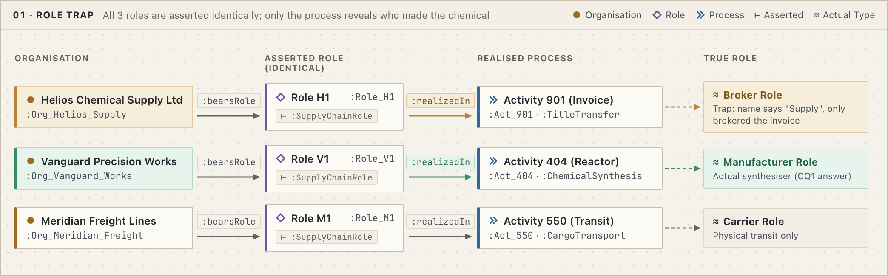
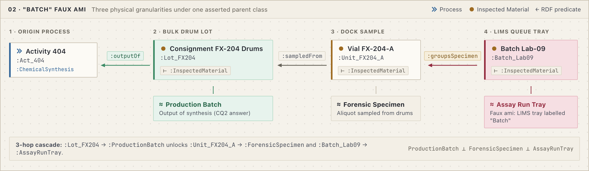
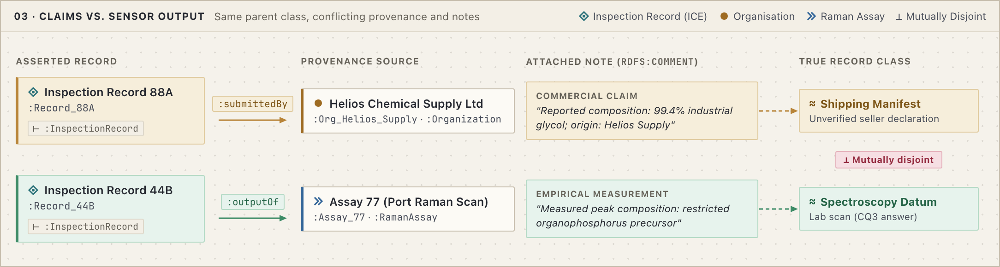

# Do Aristotelian Ontology Definitions Actually Help LLMs?

Asking an engineering team to sit down and write formal English definitions for ontology classes usually sounds like bureaucratic busywork. Give the classes sensible labels, hook up a few properties, drop in a quick comment if you have to, and let the LLM figure out the rest. That is the usual argument anyway. So I put together a small, reproducible ablation probe to test how far that holds up across a symbolic OWL 2 RL reasoner, two local MLX models, and a frontier reasoning model.

The test scenario sits at the boundary between Pharma QA and Border Customs screening, modelled in BFO 2020 (ISO/IEC 21838-2) and IAO. It defines 12 core domain classes (grouped into three sibling triads: roles, inspected materials, and inspection records) alongside 15 named individuals describing a single detained shipment, Consignment FX-204. None of the target entities are pre-classified into their specific leaf classes in the ABox; every system has to classify them from the graph relations, definitions, and axioms alone across three competency questions (CQ1, CQ2, CQ3) plus one deliberate disjointness clash (`04_clash`).

## The Three Semantic Traps

Consignment FX-204 is built around three common cross-domain traps where surface naming either misleads or collapses distinct entities under a single generic parent class.


*Trap 1 (CQ1, `:ManufacturerRole`): All three organisations bear an undifferentiated `:SupplyChainRole`; only the realised process separates the actual manufacturer (`:Org_Vanguard_Works`) from a broker named "Helios Chemical Supply Ltd" (`:Org_Helios_Supply`).*


*Trap 2 (CQ2, `:ProductionBatch`): Three physical granularities sit under `:InspectedMaterial`, including a classic LIMS faux ami (`:Batch_Lab09`, an analytical tray labelled "Batch") alongside the actual synthesis lot (`:Lot_FX204`) and a sampled vial (`:Unit_FX204_A`).*


*Trap 3 (CQ3, `:SpectroscopyDatum`): Both `:Record_88A` and `:Record_44B` mention chemical composition in their comments, but one is an unverified supplier manifest (`:ShippingManifest`) while the other is the output of a port Raman scan (`:SpectroscopyDatum`).*

## Headline Results

All raw model outputs, rationales, and ontology variants are checked into this repository so every figure below can be regenerated directly from the saved JSON logs and Turtle files.

### 1. Symbolic OWL 2 RL (`owlrl`) + SPARQL & SRS-17 Linter

A symbolic reasoner ignores English comments completely. Without formal OWL axioms, it returns zero matches regardless of how well the definitions are written. Once OWL 2 RL equivalence and disjointness axioms mirror the strict definitions (`03_full`), SPARQL recovers all three answers deterministically, derives the full 3-hop material cascade (`:Lot_FX204 -> :ProductionBatch`, `:Unit_FX204_A -> :ForensicSpecimen`, `:Batch_Lab09 -> :AssayRunTray`), and catches the injected contradiction in `04_clash`.

| Ontology Variant | SRS-17 Linter Flags | SPARQL (Raw Graph) | SPARQL (OWL 2 RL Closure) | Consistency / Notes |
| --- | :---: | :---: | :---: | --- |
| `01_bare_no_defs_no_axioms.ttl` | n/a (0 defs) | `0/3` | `0/3` | Consistent; no classifying axioms |
| `02a_sloppy_defs_no_axioms.ttl` | `5/12` flagged | `0/3` | `0/3` | Consistent; flags `Circular`, `Examples`, and `Hedge` rules |
| `02b_strict_defs_no_axioms.ttl` | `0/12` flagged | `0/3` | `0/3` | Consistent; clean Aristotelian `S = G + D` definitions only |
| `03_full_bfo_axioms_and_strict_defs.ttl` | `0/12` flagged | `0/3` | `3/3` | Consistent; returns `Org_Vanguard_Works`, `Lot_FX204`, `Record_44B` + 3-hop cascade |
| `04_clash_manifest_as_spectroscopy.ttl` | `0/12` flagged | `0/3` (CQ3 returns `:Record_88A`) | Clash detected | Inconsistent on `:Record_88A` (`:ShippingManifest` disjoint with `:SpectroscopyDatum`) |

### 2. Local MLX Models (5 runs/CQ, 15 runs/condition, non-thinking mode)

The local runs compare two prompt regimes defined in `prompts/`: a reason-first RAG prompt (`rag_reason_first.txt`, emitting `reason` before `matches`) and a conservative abstain prompt (`conservative_abstain.txt`, emitting `matches` before `reason` and instructing the model to return `[]` unless deterministically justified).

| Condition | `Qwen3.5-35B-A3B-4bit` (RAG) | `Qwen3.5-35B-A3B-4bit` (Abstain) | `Qwen3-0.6B-4bit` (Abstain) |
| --- | :---: | :---: | :---: |
| `1B_bare_masked_ids` (`:CLASS_01`..`:CLASS_12`) | `0.0%` (`0/15`) | `0.0%` (`0/15`) | `0.0%` (`0/15`) |
| `1A_bare_labels_only` | `53.3%` (`8/15`) | `0.0%` (`0/15`) | `0.0%` (`0/15`) |
| `2A_sloppy_defs_only` | `93.3%` (`14/15`) | `0.0%` (`0/15`) | `0.0%` (`0/15`) |
| `2B_strict_defs_only` | `100.0%` (`15/15`) | `60.0%` (`9/15`) | `0.0%` (`0/15`) |
| `3_reasoner_plus_strict` | `100.0%` (`15/15`) | `66.7%` (`10/15`) | `0.0%` (`0/15`) |

Two small details are worth noting in the local logs. First, `Qwen3-0.6B` failed every condition by listing all candidate individuals regardless of the graph (including false positives even after reasoner materialisation). Second, `Qwen3.5-35B` in matches-first abstain mode scored `0/5` on CQ2 even under `3_reasoner_plus_strict`: without thinking tokens, it emitted `"matches": []` first and then immediately wrote in `"reason"` that only `:Lot_FX204` was typed as `:ProductionBatch`. Switching to reason-first JSON ordering resolved that completely (`15/15`).

### 3. Frontier Gemini Reasoning Model (3 blind runs/CQ, 9 runs/condition)

| Condition | RAG Mode (Reason-First) | Conservative Abstain Mode | Key Behaviour |
| --- | :---: | :---: | --- |
| `1B_bare_masked_ids` | `0.0%` (`0/9`) | `0.0%` (`0/9`) | Abstains cleanly when labels and axioms are stripped |
| `1A_bare_labels_only` | `100.0%` (`9/9`) | `0.0%` (`0/9`) | Infers from English labels in RAG; refuses to guess in Abstain |
| `2A_sloppy_defs_only` | `33.3%` (`3/9`) | `0.0%` (`0/9`) | Follows sloppy definitions literally and adds false positives |
| `2B_strict_defs_only` | `100.0%` (`9/9`) | `100.0%` (`9/9`) | Clean genus-differentia definitions resolve all three traps |
| `3_reasoner_plus_strict` | `100.0%` (`9/9`) | `100.0%` (`9/9`) | Full agreement with materialised OWL 2 RL closure |
| `04_clash` (CQ3, no reasoner error log) | `100.0%` (`3/3`) | n/a | Rejects misasserted `:Record_88A` via `owl:disjointWith` |

### The Core Takeaway

The most revealing drop in the entire table is `2A_sloppy_defs_only` on the frontier reasoning model. Given bare labels alone (`1A`), the frontier model used its world knowledge to get `100.0%` (`9/9`) in RAG mode. As soon as we added casual, real-world-style definitions (`2A`), its accuracy collapsed to `33.3%` (`3/9`) in RAG mode and `0.0%` (`0/9`) in strict abstain mode.

Why did that happen? Because a strong model takes the ontology's own definitions seriously. In `02a_sloppy_defs_no_axioms.ttl`, `:ManufacturerRole` says *"provides, sources, or supplies chemical materials (e.g., factories or wholesale vendors)"*, `:ProductionBatch` explicitly includes *"synthesis lots or assay trays"*, and `:SpectroscopyDatum` mentions only *"technical data describing the chemical composition of an inspected batch"*. Reading those definitions faithfully forced the model to classify broker `:Org_Helios_Supply` as a manufacturer, LIMS tray `:Batch_Lab09` as a production batch, and (in abstain mode) supplier claim `:Record_88A` as a spectroscopy datum.

Bad prose definitions are not neutral noise: they actively override a frontier model's better instincts. Writing strict Aristotelian `S = G + D` definitions (`2B`) fixes the textual ambiguity (`100.0%` in both modes), and backing them with OWL 2 RL equivalence and disjointness axioms (`03_full` and `04_clash`) gives both the symbolic engine and the LLM an explicit logical boundary when incoming data contradicts itself.

## Quickstart

Clone the repository and install the minimal dependencies (`rdflib`, `owlrl`, and `pytest`):

```bash
pip install -r requirements.txt
```

Run the symbolic verification, SRS-17 Aristotelian definition linter, saved-results aggregator, and test suite:

```bash
python scripts/verify_symbolic.py
python scripts/lint_definitions.py
python scripts/summarize_results.py
pytest -v
```

### Re-running the LLM Evaluation on Your Own Models

`scripts/run_llm_eval.py` lets you run the exact same prompt battery and ablation matrix against OpenAI, Ollama, Gemini, Anthropic, or a local MLX server. Start with a zero-API dry run to inspect the planned evaluation matrix:

```bash
python scripts/run_llm_eval.py --dry-run
```

Then point it at your preferred provider (set `OPENAI_API_KEY`, `GEMINI_API_KEY`, or `ANTHROPIC_API_KEY` where required, and add `--include-clash` or `--out results/my_run.json` as needed):

```bash
# OpenAI
python scripts/run_llm_eval.py --provider openai --model gpt-4o --mode rag --repeats 3

# Local Ollama (via OpenAI-compatible endpoint)
python scripts/run_llm_eval.py --provider openai --base-url http://localhost:11434/v1 --model qwen2.5:32b --mode rag --repeats 5

# Google Gemini
python scripts/run_llm_eval.py --provider gemini --model gemini-2.5-pro --mode abstain --repeats 3 --include-clash

# Anthropic Claude
python scripts/run_llm_eval.py --provider anthropic --model claude-sonnet-4-20250514 --mode rag --repeats 3

# Local Apple Silicon MLX (requires mlx-lm)
python scripts/run_llm_eval.py --provider mlx --model mlx-community/Qwen3.5-35B-A3B-4bit --mode both --repeats 5
```

## Repository Layout

```text
bfo-definitions-llm-experiment/
├── figures/                              # Priory trap diagrams embedded above
│   ├── 01_role_trap.png
│   ├── 02_batch_faux_ami.png
│   └── 03_claims_vs_sensor.png
├── ontologies/                           # Five controlled OWL 2 / BFO 2020 Turtle variants
│   ├── 01_bare_no_defs_no_axioms.ttl
│   ├── 02a_sloppy_defs_no_axioms.ttl
│   ├── 02b_strict_defs_no_axioms.ttl
│   ├── 03_full_bfo_axioms_and_strict_defs.ttl
│   └── 04_clash_manifest_as_spectroscopy.ttl
├── prompts/                              # Exact system prompts and CQ wording
│   ├── conservative_abstain.txt
│   └── rag_reason_first.txt
├── queries/                              # SPARQL competency queries (CQ1, CQ2, CQ3)
│   ├── cq1_manufacturer_role.sparql
│   ├── cq2_production_batch.sparql
│   └── cq3_spectroscopy_datum.sparql
├── results/                              # Raw JSON trial logs behind every published number
│   ├── frontier_gemini_trials.json
│   ├── local_mlx_abstain_mode.json
│   ├── local_mlx_rag_mode.json
│   └── symbolic_report.json
├── scripts/                              # Symbolic reasoner, linter, summariser, and eval runner
│   ├── __init__.py
│   ├── lint_definitions.py
│   ├── run_llm_eval.py
│   ├── summarize_results.py
│   └── verify_symbolic.py
├── tests/
│   └── test_reproducibility.py           # End-to-end verification of ontologies, scripts, and JSON logs
├── LICENSE
├── pyproject.toml
├── README.md
└── requirements.txt
```

## Methodology & Limitations

This repository is a small diagnostic probe, not a large benchmark leaderboard. Keeping the ontology to 12 core classes, 15 individuals, and 3 competency questions makes every failure mechanism easy to inspect by eye, which is the point here, but it also means the percentages should be read as directional behaviour on controlled traps rather than universal scores across arbitrary enterprise graphs.

A few execution differences between the saved local and frontier logs are also worth keeping in mind:

- **Sample sizes and decoding setups differ by harness.** The local MLX runs executed 5 runs per CQ per condition (`temp = 0.0` on run 1, `temp = 0.5` on runs 2 to 5) with thinking tokens disabled (`non-thinking` mode). The frontier Gemini trials executed 3 independent blind runs per CQ per condition through a zero-tool agent harness with a structured finish schema.
- **Prompt ordering matters for non-thinking models.** As seen on `Qwen3.5-35B` in `results/local_mlx_abstain_mode.json`, asking a non-thinking model to output `matches` before `reason` can cause premature abstention even when the reasoner output is right there in context.
- **Single scenario and handcrafted sloppy definitions.** The sloppy definitions in `02a_sloppy_defs_no_axioms.ttl` were written to mirror real enterprise anti-patterns (circular wording, `"e.g."` examples, `"Typically..."`, and cross-sibling scope bleed). Different domains or milder definition flaws will naturally produce different error rates.

Readers are actively encouraged to rerun `scripts/run_llm_eval.py` against their own models, prompt templates, and temperature settings, or swap in their own domain triads to see where their models start tripping over casual prose.

## License

Released under the [MIT License](LICENSE).
